# 架构

## 模块与平台

Ziggurat 的依赖指向小内核。核心拥有 App/Window 生命周期、关闭策略、主线程任务、诊断和原生安全点；内容与扩展模块只依赖这套契约。工具链固定 Zig 0.15.2，复杂系统 ABI 通过局部 C 适配，由同一工具链编译，不需要 C++ 运行时。

```mermaid
flowchart TD
    Host[应用状态 / 显式后台线程] --> Core[ziggurat: App / Window / Content]
    Host --> UI[ziggurat_ui]
    Host --> Web[ziggurat_webview]
    Host --> Runtime[ziggurat_webview_runtime]
    Host --> IPC[ziggurat_ipc]
    Host --> System[ziggurat_system]
    Host --> Update[ziggurat_update]
    Host --> Assets[ziggurat_assets]
    Host --> Extensions[ziggurat_extensions]
    Host --> Text[ziggurat_text_layout]
    Host --> TextOutlines[ziggurat_text_outlines]
    Host --> SVGText[ziggurat_svg_text]
    Host --> Images[ziggurat_images]
    Host --> ImageDrawing[ziggurat_image_drawing]
    Host --> Editor[ziggurat_shaped_editor]
    Host --> List[ziggurat_virtual_list]
    Host --> View[ziggurat_view]
    Host --> Document[ziggurat_document]
    Host --> DocumentEditor[ziggurat_document_editor]
    Host --> DocumentAccessibility[ziggurat_document_accessibility]
    Host --> CodeEditor[ziggurat_code_editor]
    Host --> DocumentDiff[ziggurat_document_diff]
    Host --> DocumentDiffView[ziggurat_document_diff_view]
    Host --> DocumentDiffAccessibility[ziggurat_document_diff_accessibility]
    Host --> SVG[ziggurat_svg]
    Host --> Vector[ziggurat_vector]
    Host --> Shadows[ziggurat_shadows]
    Host --> Animation[ziggurat_animation]
    Host --> Wake[ziggurat_wake]
    Host --> Placement[ziggurat_window_placement]
    Host --> DocumentApp[ziggurat_document_app]
    Host --> LanguageProtocol[ziggurat_language_protocol]
    Host --> Producer[ziggurat_webview_producer]
    Host --> ResourceStream[ziggurat_resource_stream]
    Host --> NativeStream[ziggurat_native_stream]
    Host --> FileStream[ziggurat_file_stream]
    Host --> HTTP[ziggurat_http_response]
    Host --> HTTPSResources[ziggurat_https_resources]
    Host --> Caret[ziggurat_caret]
    Host --> Gaussian[ziggurat_gaussian]
    Wake --> Core
    Placement --> Core
    DocumentApp --> Core
    LanguageProtocol --> Core
    LanguageProtocol --> Document
    LanguageProtocol --> CodeEditor
    Producer --> Web
    Producer --> IPC
    Producer --> ResourceStream
    UI --> Core
    Web --> Core
    Web --> HTTP
    HTTPSResources --> Core
    HTTPSResources --> HTTP
    HTTPSResources --> FileStream
    HTTPSResources --> HTTPNative[可选 Linux libsoup / GIO 或 Windows Winsock / TLS1.2]
    System --> Core
    Core --> Native[Win32 或 GTK3 / GLib]
    UI --> Draw[GDI / D3D11 + DirectWrite / Cairo + Pango]
    Web --> WV[WebView2 COM / 可选 WebKitGTK 4.1]
    Runtime --> RuntimeDiscovery[显式 worker / Windows loader 或 Linux DSO 版本查询]
    Text --> Shaping[DirectWrite + 系统 ICU / Pango]
    Images --> Codecs[系统 WIC / GdkPixbuf]
    ImageDrawing --> Images
    ImageDrawing --> Resources[纯数据绘制资源 ABI]
    UI --> Resources
    Text --> Resources
    Editor --> UI
    Editor --> Text
    Editor --> Caret
    DocumentEditor --> Caret
    List --> UI
    View --> UI
    Document --> Core
    Vector --> Resources
    Shadows --> Resources
    Gaussian --> Resources
    Web --> FileStream
    FileStream --> FileNative[Linux GIO / POSIX 或 Windows 有界 channel / 文件泵]
    NativeStream --> FileStream
    SVG --> Vector
    SVG --> Resources
    TextOutlines --> Text
    TextOutlines --> Vector
    SVGText --> SVG
    SVGText --> Text
    SVGText --> TextOutlines
    DocumentEditor --> Document
    DocumentEditor --> Core
    DocumentEditor --> UI
    DocumentEditor --> Text
    DocumentAccessibility --> Document
    DocumentAccessibility --> DocumentEditor
    DocumentAccessibility --> Core
    DocumentAccessibility --> UI
    DocumentDiffAccessibility --> DocumentDiffView
    DocumentDiffAccessibility --> DocumentAccessibility
    DocumentDiffAccessibility --> Core
    DocumentDiffAccessibility --> UI
    DocumentDiffAccessibility --> Document
    CodeEditor --> Document
    CodeEditor --> DocumentEditor
    CodeEditor --> Core
    CodeEditor --> UI
    CodeEditor --> Text
    DocumentDiff --> Document
    DocumentDiffView --> DocumentDiff
    DocumentDiffView --> DocumentEditor
    DocumentDiffView --> Core
    DocumentDiffView --> UI
    DocumentDiffView --> Text
```

| 层 | 所有权与行为 |
| --- | --- |
| 核心 | 窗口记录、句柄代数、关闭次序、任务入口、回调固定、安全点 |
| 平台 | 原生窗口、消息循环、DPI、输入法与原生事件转换 |
| 自绘 | 输入身份、绘制命令、布局/编辑模型、绘制资源、语义快照 |
| WebView | 异步 controller、来源与策略、内存资源、独立 COM 状态 |
| IPC | 服务类型、协议解析、固定请求槽、取消与流背压 |
| 扩展 | 系统设施、磁盘资源与签名更新，各自公开能力与成本 |
| 应用 | 业务状态、线程、网络、资源交接、退出与重启策略 |

`ziggurat_extensions` 以每个应用自己的固定容量依赖图组织可选插件；先校验整个图，再按依赖初始化，失败逆序回滚，关闭回调不会早于依赖它的插件。它不导入核心或自动绑定服务；主线程工作、异步取消和 join 仍由宿主显式安排。详见[扩展生命周期](extensions.md)。

Windows 已有实际 Win32/GDI、D3D11、UIA、WebView2 和系统设施检查。Linux GTK3/GLib/Cairo/Pango已有原生运行验证，可选WebKitGTK已验证显式临时profile的可信HTML/顶层IPC/页面/脚本、独立持久Profile、custom静态与异步资源、显式worker文件流，以及依赖私有请求策略扩展的远程页面。文件流和远程策略默认关闭，分别沿用显式容量、取消及来源契约；独立矩形页面区域沿用核心Owner/Region，GTK层与child引用覆盖最后释放，PageSession可离窗停放并保留跨宿主DOM。持久目录由宿主worker准备，Profile属于单一App，晚到Context/manager只保留C存储与锁；逻辑close不提供引擎退出或fsync屏障，见[存储合同](webview-profile.md)。内存/文件资源的HTTPS运输与更广策略继续实施。macOS和其他系统扩展按能力返回不支持，不用空实现表示成功。

Linux Profile 可显式冻结宿主既有回环 HTTPS 服务的证书例外与直连策略。单一 `127.0.0.1` 例外作用于整个 manager/session 的 host 范围，端口不隔离 Cookie，也不是强制证书 pin；正常 TLS 验证和精确 origin/method/header/IPC 门禁仍各自成立。每个 Context 发布前应用同一配置；已接受 reload/recover 不因之后 Profile seal 而丢失责任。证书在首次 caller allocator 回调前独立捕获，默认路径不构造证书；服务、私钥、worker 和网络预算由宿主管理，本层不启动服务器或开放 Linux `local_site`。

可选 `ziggurat_native_stream` 为 Linux/Windows 已知长度字节提供独立 Source/Writer。Source 是既有文件模块的中性 consumer 协议别名，文件 Pump 与生成 Writer 在同一 C channel/physical ledger 下由明确 kind 区分；HTTPS 仍只依赖该 consumer，不依赖生产模块。worker 显式生成至多16KiB输入并等待接受/容量，HEAD不调用生成器，来源认证和页面变更时的撤销由宿主承担。socket/HTTP写出不是页面消费ACK；逻辑取消与最后物理引用回收分开，见[原生字节生产者](native-stream.md)。Windows 显式 HTTPS 采用 worker prepare → main adopt → 原 worker run，不把未知长度生产塞入已有 COM 文件响应；全部 TLS/socket payload 由原 worker 退休，App 覆盖所有 post 与 worker join。可选固定 TLS 只随显式 HTTPS 构建，普通 Core/UI/WebView/file 不链接它。实际浏览器检查使用隔离固定 leaf 测试例外；生产仍走正常系统验证，独立 Profile 级显式 pin 尚未实现，见[Transport](https-owned-transport.md)。

## 句柄与生命周期

Linux 的可选 `CookieStore` 直接持有 Profile 的 C-only lease 和 manager 引用，不借 View/Context/Window 建立第二生命周期。它独立注册 App Stop，先撤销逻辑槽再完成回调；取消不保证回滚引擎变更，迟到 GTask 最后释放后才回收 C 操作和 manager。结果 Batch 由调用者 allocator 独立拥有，可以跨 Store/App 存活；`on_closed` 仅表示最后一次 Zig 使用结束，不是引擎持久化或所有原生引用释放屏障。预算和系统内部分配边界见[Cookie 存储](cookie-store.md)。

`App.init(allocator)` 分配稳定 App，并初始化进程主线程的平台状态。一个 App 单次运行，可顺序创建新 App。`createWindow` 创建隐藏窗口；应用附加内容后显式 show。窗口尺寸、最小客户区尺寸与输入坐标使用 DIP，Paint 同时携带像素尺寸与 scale。

`Window` 是可复制值，保存 App 指针与槽位 `{index,generation}`。槽位查找、移除和空槽复用 O(1)，扩容摊销；代数耗尽退休而不回绕。原生记录独立分配，通过活动和待销毁侵入链表维护，关闭不扫描历史窗口。槽位元数据随并发峰值保留，记录在固定释放后及时归还 allocator。

App 拥有原生记录，每个窗口有一个可选 Content 和一个可选 WindowService。Content 拥有事件、detach 与可访问性查询入口；WindowService 接入菜单、托盘等独立设施，不能吞掉核心关闭/销毁消息。系统命令 ID 由窗口单调保留，在同一窗口生命周期内不复用，避免旧排队事件路由到新 Owner。

可选使用核心 composition.Owner 作为唯一 Content，将多个 provider 接入预分配的区域槽。Region 包含 Owner、slot、generation，移除立即阻断入口，最后一个同时 pin Region/Window 的 scope 退出后才 detach；先关闭原生区域，最后关闭全窗 backdrop。attach/update 由 provider 准备候选和回滚，Owner 成功后发布 attachment/viewport；几何和输入状态不按地址猜测归属。该层不导入 renderer、WebView，不代替完整混合合成/焦点/可访问树，见[内容组合](composition.md)。

Context/View/服务地址在 detach 前稳定；窗口回调上下文保持到 `on_closed`，共享上下文取更长生存期。App 覆盖所有句柄的使用期；App.deinit 后不能再使用包括 isClosed 在内的任何句柄方法。

TextClient 解绑先撤原生入口，再通知唯一旧客户端 `unbound`。解绑期间同步到来的原生 preedit 取消使用 `text_preedit_revoked` 生命周期事件，只清 Context 的 composing 状态，不再进入旧业务 `on_input`；文档组合由 `unbound` 清理。标记仅覆盖原生撤销调用，并在旧客户端通知前恢复；普通显式取消及回调中已安装的新连接继续使用普通输入语义。Windows 本地组合、decoder 和 reconversion 状态在通知前撤销，回调后的新状态不由旧操作尾部覆盖。详见[原生文本上下文](text-input.md)。

| 操作 | 语义 |
| --- | --- |
| Window.requestClose | 同步询问 on_close；原生关闭按钮传入 user 原因 |
| Window.destroy | 绕过否决，重复关闭幂等 |
| App.requestQuit | quit 原因预检所有窗口；出现否决不执行自动关闭 |
| App.quit | 绕过否决、关闭任务入口并请求结束循环 |

窗口请求返回 closed、cancelled、deferred 或 in_progress。deferred 表示已接受并进入关闭阶段；isClosed 包含该阶段，不是释放上下文的依据。重入关闭询问返回 in_progress；退出预检期间拒绝新建窗口，不回滚应用回调主动发起的强制关闭。

原生/窗口内容回调固定窗口记录并进入活动作用域；独立 PageSession 的普通页面操作固定 App/Session，涉及 provider 几何时另固定 Region/Window。作用域中的关闭只加入独立待销毁链表，全部回调退栈后的安全点执行原生销毁。外部直接销毁 HWND/GtkWidget 时，仍保留既有回调使用的 Content。先清除入口再 detach，恰好一次；随后通知一次 on_closed，失败构造不通知。正常运行时 on_closed 可创建替代窗口，stopping 后不允许创建。

退出先关闭任务入口、执行全部已接受任务，再销毁窗口、detach 和回收原生资源。run 返回后 join 后台生产者，最后 deinit App。禁止在回调中析构 App。on_closed 不是所有外部 COM 引用已经 Release 的承诺；迟到引用只访问独立的已关闭原生状态。

窗口之外的资源通过 App.registerStop 注册稳定侵入节点。seal 后禁止新入口，已接受任务执行完才整批接管节点、逆序停止，再执行普通窗口与 Cleanup 关闭；失败保留 App/backend 与节点，由 finishShutdown 显式重试。App callback scope 不依赖窗口，teardown scope 仅保证关闭期间寿命。Windows 父 WM_DESTROY 通过 Content 的早期通知同步撤离原生子树，普通 detach 仍遵守安全点。详见[应用资源与停止](application-resources.md)。

## 调度与最终释放

原生操作与 UI 回调在进程主线程。`App.post` 是跨线程边界，固定 256 项 MPSC 队列，入队/取出 mutex，空闲检查 atomic，无每次分配。空到非空才唤醒。成功投递转移执行责任，退出前执行一次；Full/Closed 不转移责任。任务上下文保持到执行，任务不得阻塞 UI。

Windows manual-reset 内核事件与合并 dispatcher 消息共同唤醒；消息队列达到配额也不丢任务。循环为输入、绘制、定时器和普通消息保留有限批次。最多 16 个借用原生 HANDLE 的 one-shot watch，在回调前撤销注册并更新代数；关闭取消注册，不关闭调用者 HANDLE。Linux 用 GLib source 与主循环结合，同样有界消费任务。空闲无持续刷新定时器或轮询。

可选纯动画模块只计算显式单调时钟下的数值、时间线位置和下一次采样请求；独立wake owner按宿主请求创建单次native期限。暂停/结束不再arm，普通App/UI不承担timer成本。Window.invalidateRect以DIP提交有界客户区damage，原生系统合并更新区域；UI仍构造完整命令/输入/语义事务，GPU回放和复杂合成不因该提示承诺局部成本。见[动画](animation.md)、[唤醒](wake.md)与[局部失效](invalidation.md)。

`Cleanup` 是资源自己持有的稳定节点，`App.deferCleanup` 在 owner 线程加入独立链表，不分配、不会因业务队列满/关闭失败。每次安全点最多执行 64 项，shutdown 清空全部；节点出队后回调可释放自身存储。回调是最终、非阻塞的资源释放，不依赖已 detach 的 Content。Windows 未回复的跨线程 SendMessage 期间推迟执行，避免 UIA 等 COM outgoing call 的 input-sync 限制。此机制不运行嵌套消息循环。

诊断使用调用者提供的同步 sink，递归报告被抑制。原生失败码在失败现场、回滚前捕获；仅附带发生过的真实原生码。诊断回调同样受活动作用域保护。详见 [诊断接口](diagnostics.md)。

## 自绘、文本与可访问性

Frame 把矩形、UTF-8 文本和 clip 写入有界命令缓冲：最多 2048 命令、64 KiB 文本、每段 2048 字节和 32 层 clip。偏移、clip、scroll 组合同时影响命中范围。非法命令或不平衡栈报告一次错误并拒绝回放。布局使用最多 256 项的 grow/shrink 饱和分配，不做每帧堆分配。

基础控件使用显式 u64 ID，最多 128 个，按下/释放同一当前 ID 才触发动作；丢捕获取消，Tab 与激活使用最近一次成功绘制的身份快照。checkbox/radio/switch/progress 与按钮共用输入、命令和语义事务；禁用或完全裁剪控件不可激活，失败帧保留旧命中快照。命中按逆绘制序线性查找，重复 ID 检查目前 O(n²)，不适合作为无限控件树。应用 on_action 更新业务状态，draw 读取状态。详见[基础控件](widgets.md)。

GDI 复用 DC、位图和字体；Linux 复用 Cairo surface 并通过 Pango 系统字体回退。可选 D3D11 使用 D2D/DirectWrite 回放同一命令缓冲。flip swapchain 绑定独立、禁用且命中透明的子 HWND，父 HWND 保留 GDI 后备能力。普通 GPU 忙通过 frame-latency HANDLE 唤醒，窗口 resize/detach 先取消 watch 再销毁 HANDLE。默认每窗口资源独立并可在后续paint恢复设备；显式DeviceDomain可共享D3D11/D2D设备与拥有型纹理，loss/stop先撤整批wait再释放payload，旧纹理代数失效，应用显式recreate/上传。该路径不隐式读回或补画软件内容，独立预算和稳定壳见[GPU资源](gpu-resources.md)。

`ziggurat_vector` 和 `ziggurat_shadows` 独立准备拥有的 A8 覆盖，只导入绘制资源 ABI。Frame 固定 Lease，renderer 显式上传；图片与 A8 共用 32 个驻留槽、一个 LRU 和合计像素预算，统计分别记录。GPU 上传/恢复为 A8 增加一圈透明 texel，使非零边缘按透明外部做双线性采样；该真实 padding 进入预算，临时上传 scratch 单列。GDI 直接读取 CPU 覆盖，Cairo 复用已建 surface/pattern。准备、上传、回放和设备恢复有不同成本，不在普通 draw 隐式生成路径或模糊。

可选 `ziggurat_gaussian` 同样只依赖绘制资源 ABI，将已合成的不可变 BGRA 快照交给宿主显式 worker，在 owner 清理候选后发布独立图片。源完整 mip retention、旧结果、候选和 scratch 共用有界账户；零 sigma 沿用原 identity/Lease，不生成第二份图片 payload。子树内部合成先于滤波，父 clip/整体 opacity 在回放时应用，不能提前裁掉光晕；自动 Frame scope、GPU 滤波和实时失效仍为后续能力，见[高斯资源](gaussian.md)。

可选 `ziggurat_svg` 在拥有的有界 XML 树上解析样式、局部引用与几何，显式准备独立的 BGRA 图片；核心和普通 UI 不导入解析器。CSS、引用展开、attribute bytes、路径生成/扫描、像素和临时透明层分别有整个场景的累计预算。准备结果走相同图片驻留和 Lease，不在 paint 解析文档。完整支持范围见[SVG 文档](svg.md)。

透明分组由 Context 在 paint 外显式预留 front/work/group 平面，软件与可用 GPU 的候选全部成功才替换旧工作面。分组在透明平面完成子项后一次应用 opacity/mask/parent clip。回放和结束失败或 GPU 暂缓呈现保留已提交前帧及输入/语义快照；软件 fallback 成功后才替换可见后端和提交新快照。关闭/资源替换先撤销借用的 ready watch。默认未启用的 Context 不分配这些平面，详见[分组工作面](layers.md)。

编辑模块拥有显式预分配的 UTF-8 文档、历史、preedit 和显示缓冲，支持选择、插入删除、剪贴板注入、撤销重做、逻辑行导航与滚动。应用提供 Surface.measure/paint 和剪贴板回调；不是自动加入 Frame 的成熟文本控件。左右按 Unicode scalar 移动，无完整 grapheme、bidi、soft wrap 或 shaping caret 模型。Windows 处理 UTF-16 surrogate、WM_UNICHAR、IMM preedit/result/cancel 与候选位置；Linux 接 GTK IM。真实语言引擎与视觉效果另行验证。

独立可选 `ziggurat_text_layout` 提供拥有的系统 shaping 快照、字素/UTF 坐标、双向/换行、双亲和性 caret 与选区查询。Engine/Layout 在主线程显式创建和关闭，复制输入，查询只读缓存。显式 `Layout.prepare` 在布局阶段准备有预算的字形覆盖；Frame 固定借用到本次全部回放结束，失败、关闭和 GPU 后备同样释放。GDI/Cairo 读取准备的覆盖，D2D 使用原生同一布局，不在 paint 重新 shaping。基础 UI 只导入无 native 依赖的绘制资源 ABI。logical selection cells 不等于 glyph ink/UIA 可见范围；容量与 Windows 查询成本见[系统文本布局](text-layout.md)。

可选 `ziggurat_shaped_editor` 保留 Editor.buffer 作为文档、选择、preedit 与历史的唯一真相。输入/resize 阶段显式 prepare，事务提交布局、视觉索引、滚动和可见覆盖；滚动/DPI 只更新覆盖，文本/字体/换行宽度变化才重新 shaping。draw/hit/caret 只读缓存，陈旧返回 LayoutRequired。独立 `ziggurat_images` 在显式 worker 解码拥有的 RGBA 像素，成功投递后由主线程独占 adopt，解码结束不留下 native codec 引用。见[编辑器](editor.md)与[图片](images.md)。

core 的保留 TextClient 只持有 opaque owner 与窗口代数，不引入第二份编辑文档。原生查询在 callback pin 内写入调用者缓冲，平台适配器验证 UTF-8/全局 UTF-16/revision，再转换 IMM 或 GTK surrounding 坐标。解绑先撤入口，原生取消失败也不恢复旧 owner；关闭等活动回调退栈后再通知 unbound。连续 Editor 通过显式 TextBinding 接入；可选 `ziggurat_document` 使用聚合 byte/UTF-16/LF 的持久 chunk 树、预算内历史和拥有型 Snapshot，为大文档提供同一 TextClient。可选 DocumentEditor 直接使用同一 Document 的文本、选区、历史和组合状态，以持久段落高度索引及有界系统 Layout 快照准备可见区域；draw 只读缓存，未知 revision 明确要求重建索引，不按猜测的 delta 改状态。成熟编辑控件继续分项实施，见[原生文本上下文](text-input.md)与[大文档视图](document-editor.md)。

独立 `ziggurat_image_drawing` 在布局或显式 worker 阶段复制、裁切并生成不可变预乘 BGRA/mip 快照。Frame 只固定本次回放借用；Cairo/D2D 的显式上传另持有驻留借用，按 32 项 LRU 和像素预算释放。候选的全部 mip 上传成功后才淘汰旧资源，失败保留旧驻留；设备丢失保留有界 CPU 描述，重建设备时恢复。显式 dynamic 上传预留两套 native bank，同尺寸更新完整写入 inactive 后才发布新 identity；CPU 快照仍不可变，静态使用不承担双 bank 像素成本。普通回放只查找缓存，GDI 直接读取像素；不在 paint 解码、生成 mip 或驱逐资源。Context 在可能关闭 GPU 等待句柄的资源操作前撤销 watch。跨后端分别提交，只保留最后一次精确 transition 以支持部分失败后的幂等重试，详见[图片绘制](image-drawing.md)。

基础 widget UIA 使用固定 128 节点/32 KiB 文本语义快照，支持 Name/Role、Invoke、Value、Text selection 与逻辑范围；它不提供精确 glyph bounds、point-to-range 或 ScrollIntoView。可选 `ziggurat_document_accessibility` 另以完整文档不可变文本、同一 Prepared 几何和有界 owner 动作提供文档查询，不将视口冒充全文。MTA 不访问活的 Document/UI；关闭先撤销 Zig 入口，外部 provider/range 持有独立 refcount 状态，失效查询和动作返回 ElementNotAvailable。缓存的 Options/host/runtime identity 保留到原生断连。完整语言单位、其他平台和屏幕阅读器兼容继续分别验收。

Linux 通用原生子节点宿主已按构造期显式选配实现并完成有界原生检查，默认保留普通 DrawingArea；核心只拥有原生宿主与绑定寿命，文档查询仍由可选模块承担。它不自动启用文档 AtkText 或 AT-SPI。单 binding、信号重入与原始销毁边界和固定成本见[宿主合同](accessibility-host.md)。

DocumentEditor 的输入与显式 `preparedHit` 快照共用无 SDK、无分配的私有命中内核。快照复制完整 Prepared 路由，保留原生精度和次序，不借活的 Adapter、Document 或 Layout；调用者拥有输出数组。Linux 文档只读 provider 将同一 packet 与可见几何复制到单块 C-owned Geometry，成功 front 一次发布，过滤域单独限定查询资格。晚到的原生查询只读该块及纯内核，不调用退休的 Zig owner。结构复制为单调遍历，ordinary 隐藏位置归一化仍有每 stop 的既有文档索引成本；这不是 CPU 期限保证。Windows point 的完整候选迁移继续独立实施，详见[文档可访问性](document-accessibility.md)。

## WebView、资源与协议

View 异步创建 environment/controller；ready 表示接口可用，页面须自行握手证明 DOM 已就绪。系统 COM 使用 STA，不嵌套泵消息伪装同步。Loader 只从 EXE 目录加载并按进程期保留，避免迟到 callback 调用已卸载代码。

本地站点可显式导航、前进/后退、刷新/停止；脚本导航仍默认拒绝。远程来源使用精确 origin 表，导航、可拦截请求与 IPC 分别授权；GET/HEAD 默认，写方法和固定浏览器集合之外的 headers 单独授权。文件可以由 worker 复制为内存快照；显式启用 file_streams 后，也可以提交 worker 预先打开并验证的完整私有文件，由独立 free-threaded IStream 在后台按需读取，没有 file:// 目录授权。每次新文档 Starting 产生属于同一个稳定 View 的 PageId，异步宿主结果用 postFor 校验，应用在 started 重置 IPC session。DOM/来源/标题/历史监听按需提供，元数据转换失败不会吞掉生命周期失效事件。详见[页面导航](pages.md)中的方法、凭据与网络拦截边界。

应用可提供 HTML 或固定 HTTPS host 的本地内存资源。初始化复制配置与资源元数据，body 按约定借用；资源按路径排序、二分查找，无请求期磁盘 I/O。同步 responder 在返回前复制 body 到 COM stream。主页面来源验证、frame、导航、弹窗、下载和权限默认拒绝；notify 先取消原生行为再回调应用。缓存的 ALLOW grant 在首次导航前有界重置，失败则不加载页面；不把浏览器配置目录当作来源安全边界。

异步资源响应最多 8 个 native/logical deferral，PageId、token 与 deadline 共同确定寿命；JS/tools/resources/permissions/download offers 五簿共用一个惰性 timer，结束一批前先摘掉全部旧槽，防止重入混入新请求。活跃下载由原生进度事件推进，没有进度轮询；下载的 view 寿命与普通页面请求的 PageId 寿命显式分开。文件流不借用 View/App/STA 指针，取消只触及独立 Control；每 attachment 的预算与进程硬上限按最后一次 COM Release 回收物理容量，EOF、逻辑 Complete、导航和取消均不提前归还。UI 只提交句柄和已复制的元数据，pending OVERLAPPED 的缓冲/栈须由后台线程排空实际完成后释放；关闭不等待后台读。完整文件在提交前已存在，Runtime 的按需读取不等于应用 ACK 协议或边生成边传输。

Linux 的私有文件机制独立为 `ziggurat_file_stream`，只有 GIO/POSIX 依赖；WebView 包装保留原 API 和元数据，普通 HTTPS consumer 可独立复用机制，但仍须实现自己的网络响应责任。生产 consumers 共用一份 C implementation 和进程物理槽，故障测试版本独立链接。Candidate abort 保留原 source/pump 可重试，consumer 不可撤销接受后再 admit；取消、HEAD、Budget close 或 stream close 都不冒充最后物理释放。native 迟到引用不访问 Zig/App，详见[文件流](file-stream.md)。

`ziggurat_http_response` 仅共享 HTTP 方法、头部规则、响应校验和拥有型元数据。WebView 保留同类型别名与自己的请求簿；独立运输层拥有自己的认证、请求、接受及取消责任。HeaderGrant 校验观察到的头部，不向请求注入凭据。

可选 `ziggurat_https_resources` 将宿主已有的单一回环 TLS SoupServer 接到独立的有界 Endpoint。服务器、监听器、私钥、worker 与网络超时仍由宿主管理；Endpoint 不创建这些资源。认证和 URI/method/header 门禁先于业务 Offer，独立 Ticket 可以跨 Endpoint/App 存活；接受前失败保留响应所有权，接受后取消仍消费责任。文件复用中立 consumer 的物理账本，一次最多一个 16KiB read 和一个发送 chunk，SDK 写出 credit 不冒充应用 ACK。Stop 先撤 Zig 入口，再取消；最后原生引用不访问 Zig owner，逻辑 close 不是网络或磁盘屏障。默认关闭，不引入 Linux 本地站点能力，见[HTTPS 资源](https-resources.md)。

浏览器 process_failed 后由应用显式 recover。reload 先准备完整候选配置，再入队重启；Full/Closed/配置失败不改变当前页面。旧 controller 关闭、资源回调解除、旧配置释放后发 resources_released，应用才能释放旧快照。detach 取消已接受重载时，在 on_closed 释放尚未移交的两份资源。独立 COM handler 状态保留迟到回调，关闭后不再访问 Zig View。

字符串双向消息均最多 64 KiB、无 NUL。`ziggurat_ipc` 在此传输之上提供编译期服务描述、生成 TS client、版本/随机 session/请求 ID、类型化错误、取消、固定槽和流 ACK 窗口。类型化事件使用独立的有界订阅表、session 与订阅代数，不消耗请求槽；广播只访问调用者显式给出的目标并逐项报告发送结果。接收 arena 只在 Received.deinit 前有效；发送失败由宿主重试已拥有 packet 或关闭 session，不能静默丢弃。详见 [IPC](ipc.md) 和 [资源工具](web-assets.md)。

## 发布与验证边界

Windows 图标、VERSIONINFO 和 DPI/asInvoker/long-path manifest 由 Zig 构建资源生成，运行时拥有并平衡图标句柄。打包、Authenticode 签名、Ed25519 更新、安装程序和 `ziggurat` 命令均为独立工具，不把证书或私钥放入应用核心。分发依赖、许可输入与系统 Runtime 前置条件见 [打包](packaging.md)；更新使用独立版本目录与原子 current marker，见 [更新](updates.md)。

单元测试使用测试后端验证不变量与故障注入；check 还实例化普通目标后端。Windows/Linux 原生 smoke 证明各自实际代码路径；编译探针不证明运行支持。GPU/文本有 pixel/readback 与输入消息验证，WebView 有真实页面/策略/恢复验证；隐藏或屏幕外检查不证明视觉质量。性能工具记录提交耗时和资源计数，不把同步 paint 返回等同于显示完成。验证范围与已知限制保留在 [性能](performance.md) 和 [路线图](roadmap.md)。
