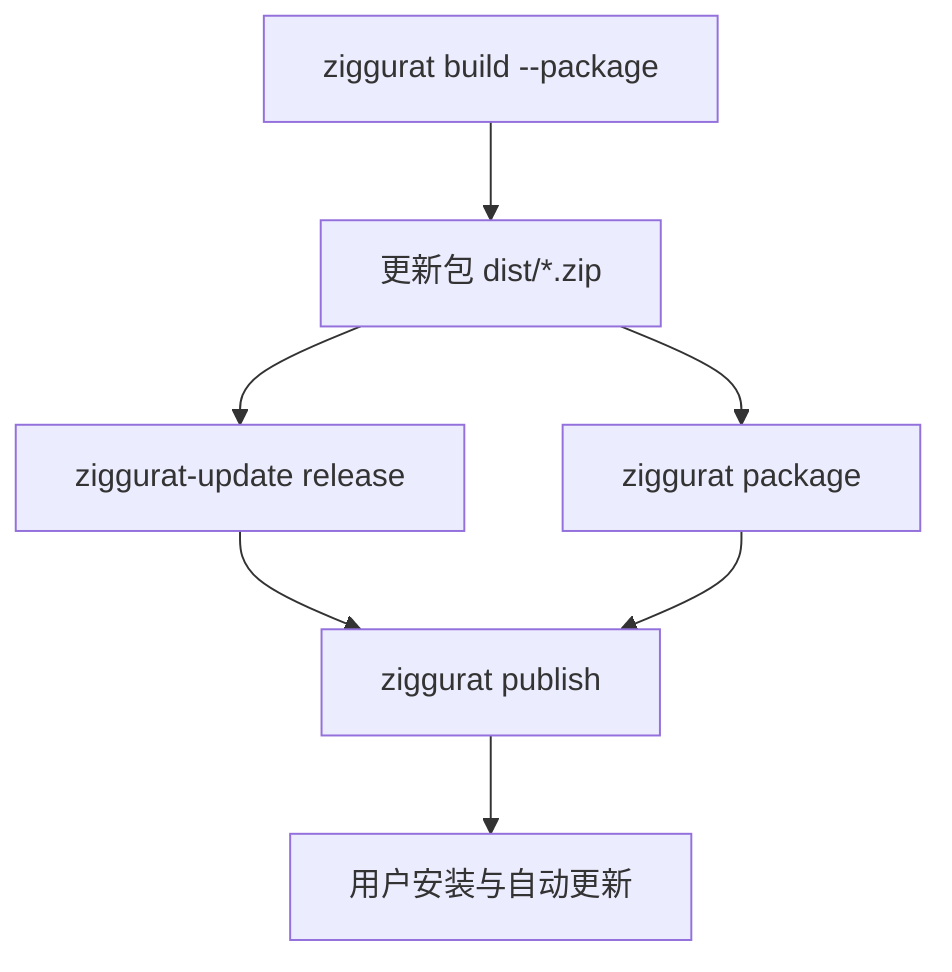

# 构建与分发

从源码到用户手里的安装程序，分为几步：构建、打包、签名发布与生成安装程序、上传。每一步都有对应的命令，也可以单独使用。



## 构建

```sh
ziggurat build                                  # ReleaseSafe，本机平台
ziggurat build --debug
ziggurat build --target x86_64-windows
ziggurat build --platform macos/universal,linux/x86_64,windows/x86_64
ziggurat build --platform web                    # 浏览器中的 WebAssembly 站点
```

- `--platform` 依次构建到 `zig-out/<os>-<arch>`；与本机相同的平台保留本机系统库，其他平台交叉编译。
- `macos/universal` 分别构建 `aarch64` 与 `x86_64`，再合成一个通用可执行文件，不需要 Xcode 的 lipo。
- `web` 写出 `index.html`、`ziggurat.js` 与 `app.wasm` 组成的静态站点，见 [浏览器](../browsers.md)。

## 打包

`--package` 读取 `ziggurat.json`，把可执行文件、Windows 上的 `WebView2Loader.dll`、项目根的 LICENSE 和图标打成**更新包**：

```text
dist/<identity>-<os>-<arch>-<version>.zip
```

更新包是排序的存储式 ZIP，带列出每个文件大小与 SHA-256 的 `package.json`，同一组输入得到同样的字节。它同时是后续所有分发形式的输入。Windows 上，配置了 `windows.certificate` 或 `windows.signCommand` 时，打包前会先签署可执行文件。

## 安装程序

| 命令 | 产物 |
| --- | --- |
| `ziggurat package setup --zip PACKAGE` | 单文件安装程序（Windows/Linux），支持用户范围与机器范围、静默安装、卸载与安装钩子 |
| `ziggurat package deb --zip PACKAGE --maintainer "NAME <EMAIL>"` | Debian 包 |
| `ziggurat package rpm --zip PACKAGE` | RPM 包（Fedora、openSUSE 等） |
| `ziggurat package pkgbuild --zip PACKAGE` | Arch Linux 的 PKGBUILD |
| `ziggurat package linux --zip PACKAGE --maintainer "NAME <EMAIL>"` | `linux.formats` 列出的全部 Linux 包 |
| `ziggurat package app --zip PACKAGE [--dmg]` | macOS 应用包与磁盘映像 |
| `ziggurat package install-script --zip PACKAGE` | `install.sh`，Linux 与 macOS 通用，可以 `curl … | sh` |
| `ziggurat package install-ps1 --zip PACKAGE` | `install.ps1`，可以 `irm … | iex` |

用户范围安装（默认）不需要管理员权限，装到 `%LOCALAPPDATA%\Programs\<identity>` 或 `$XDG_DATA_HOME/<identity>/install`，应用之后可以自己更新。安装复用更新的发布事务：先校验摘要与清单，再原子切换当前版本。详见 [资源、打包与安装程序](../packaging.md)。

## macOS 应用包

目标是 macOS 时，`ziggurat build` 还会在 `dist/macos-<arch>/` 写出签名的 `<名称>.app`，并在 Mac 上写出磁盘映像。签名身份取 `--sign`，否则 `macos.signingIdentity`，默认 ad hoc；配置了 `macos.notarize` 时映像会提交公证（`--skip-notarize` 跳过）。分发给其他 Mac 需要 Developer ID 身份与公证。

开发时 `ziggurat dev` 构建名为“NAME Dev”、标识为 `IDENTITY.dev` 的开发版应用包，用钥匙串里的 Apple Development 身份签名，这样 macOS 会记住授予它的辅助功能、屏幕录制等权限。

## Windows 签名

在 `ziggurat.json` 中配置 `windows.certificate`（密码来自 `ZIGGURAT_WINDOWS_CERTIFICATE_PASSWORD`）或 `windows.signCommand`。`build --package` 签署可执行文件，`package setup` 在追加更新包之后签署安装程序，`ziggurat sign FILE...` 签署任意文件。已由发布者签名的库（如 `WebView2Loader.dll`）保持原签名。见 [项目配置](./configuration.md#windows)。

## 自动更新

更新由 `ziggurat_update` 负责：Ed25519 签名的元数据、发布索引 `feed.json`、可续传下载、增量补丁、ZIP 清单核验、版本目录发布、保留与回滚。

```sh
zig build update-tool -Doptimize=ReleaseSafe
ziggurat-update keygen release.seed release.pub   # 私钥 seed 妥善保管，不放进分发包
ziggurat-update release site com.example.hello linux-x86_64 1.2.0.0 \
  dist/com.example.hello-linux-x86_64-1.2.0.0.zip release.seed https://example.com/hello/ \
  --notes NOTES.md --from old.zip 1.1.0.0
```

`release` 把完整归档、签名清单和增量补丁写进静态发布目录，并重建 `feed.json`。应用内固定公钥与当前版本（`Policy`），检查、下载与发布都放在应用自己的线程。

不想自己写界面时，`ziggurat_updater` 提供现成的更新窗口：后台定期检查，显示版本与 Markdown 更新说明，“安装更新 / 跳过此版本 / 稍后提醒”，可取消的下载进度，以及完成后重新启动。支持 beta 通道与应用自己的更新源。详见 [签名更新与版本发布](../updates.md)。

## 发布

```sh
ziggurat publish site --github OWNER/REPO --tag v1.2.0 --notes NOTES.md
ziggurat publish site --s3 BUCKET --url https://downloads.example.com/hello/ --prefix hello/
```

上传顺序保证任何时刻读到的 `feed.json` 都不会指向尚未上传的文件：先传归档、补丁与安装程序，再传签名清单，最后传索引。GitHub 发布通过 GitHub CLI 创建草稿；S3 发布使用 AWS Signature Version 4，也支持 Cloudflare R2 等兼容服务，凭据只从环境变量读取。

## 检查清单

- `ziggurat doctor`：工具链、平台依赖、签名身份、`ziggurat.json`。
- `ziggurat vet`：语法检查，以及视图生命周期规则（`*view.View` 与 `*ui.Frame` 不能存进字段或交给线程）。
- `ziggurat i18n check`：消息目录的错误与缺失翻译。
